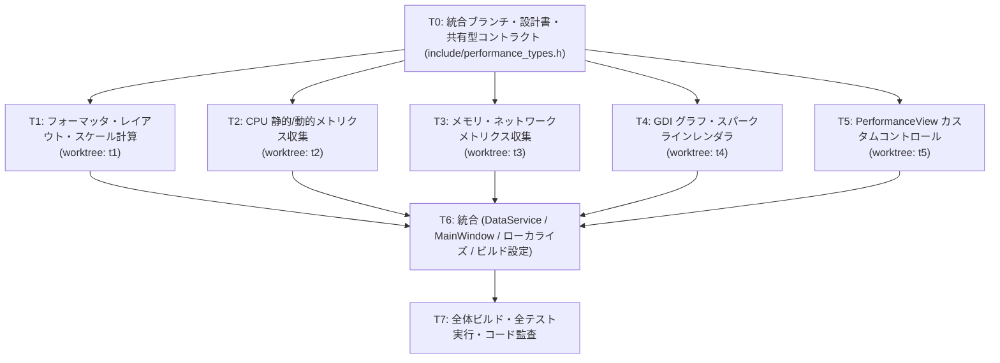

# パフォーマンス タブ実装スケジュール & タスク分割

## 1. タスク依存関係図

---

## 2. タスク一覧（並列 Worktree 構成）

| ID | ブランチ名 | Worktree パス | 所有ファイル（完全非重複） | 依存 | 完了条件 |
|---|---|---|---|---|---|
| **T0** | `feature/performance-tab` | メインリポジトリ | `docs/performance_tab_design.md` `docs/performance_tab_schedule.md` `include/performance_types.h` | なし | 設計書・スケジュール書・共有型ヘッダのコミット完了 |
| **T1** | `feature/perf-t1-history-format` | `../LiteProcManager-wt/t1` | `include/performance_formatter.h` `src/performance_formatter.cc` `tests/performance_formatter_test.cc` | T0 | 稼働時間・メモリ・キャッシュ・周波数・ビットレート・グリッド・オートスケール実装とテスト作成 |
| **T2** | `feature/perf-t2-cpu-collector` | `../LiteProcManager-wt/t2` | `include/cpu_performance_collector.h` `src/cpu_performance_collector.cc` `tests/cpu_performance_collector_test.cc` | T0 | CPU 静的情報・コア別使用率デルタ・周波数・システムカウント収集とテスト作成 |
| **T3** | `feature/perf-t3-mem-net-collector` | `../LiteProcManager-wt/t3` | `include/memory_network_collector.h` `src/memory_network_collector.cc` `tests/memory_network_collector_test.cc` | T0 | メモリ構成・NIC フィルタ・スループットデルタ収集とテスト作成 |
| **T4** | `feature/perf-t4-graph-renderer` | `../LiteProcManager-wt/t4` | `include/performance_graph_renderer.h` `src/performance_graph_renderer.cc` `tests/performance_graph_renderer_test.cc` | T0 | ライト/ダークグラフ描画・スパークライン・メモリバー描画と GDI リークゼロテスト作成 |
| **T5** | `feature/perf-t5-view-control` | `../LiteProcManager-wt/t5` | `include/performance_view.h` `src/performance_view.cc` | T0 | サイドバー＋詳細ペイン＋ダブルバッファ＋右クリック切替メニュー実装 |
| **T6** | `feature/performance-tab` | メインリポジトリ | `include/performance_data_service.h` `src/performance_data_service.cc` `tests/performance_data_service_test.cc` `include/main_window.h`, `src/main_window.cc` `include/resource.h`, `src/resource.rc` `include/language_manager.h`, `src/language_manager.cc` `*.vcxproj`, `**/CMakeLists.txt` | T1..T5 | T1〜T5 マージ、Worktree 削除、MainWindow・ローカライズ・ビルド定義統合 |
| **T7** | `feature/performance-tab` | メインリポジトリ | 全体検証 | T6 | `msbuild` Release x64 成功、`vstest.console.exe` 全テスト合格、監査スクリプト合格 |

---

## 3. マージおよび検証スケジュール

1. **フェーズ 0 (準備)**: ブランチ `feature/performance-tab` 作成、設計書・スケジュール書・`performance_types.h` コミット。
2. **フェーズ 1 (並列開発)**: `t1`〜`t5` の 5 つの `git worktree` を作成し、5 体のサブエージェントを同時起動。所有ファイルを厳密に分離することでコンフリクト発生を最小化。
3. **フェーズ 2 (マージ・統合)**: T1→T2→T3→T4→T5 の順に `feature/performance-tab` へ `--no-ff` マージし、一時 Worktree を撤去。続いて T6（`PerformanceDataService`, `MainWindow` タブ統合, `LanguageManager` / `resource.rc`, `.vcxproj` / `CMakeLists.txt`）を実装。
4. **フェーズ 3 (検証)**: VS2026 環境で `LiteProcManager.sln` (Release|x64) ビルド、全ユニットテスト実行、`.agents/skills/code-check/scripts/run_audit_checks.ps1` による監査を実施し、問題ゼロで最終コミット。
